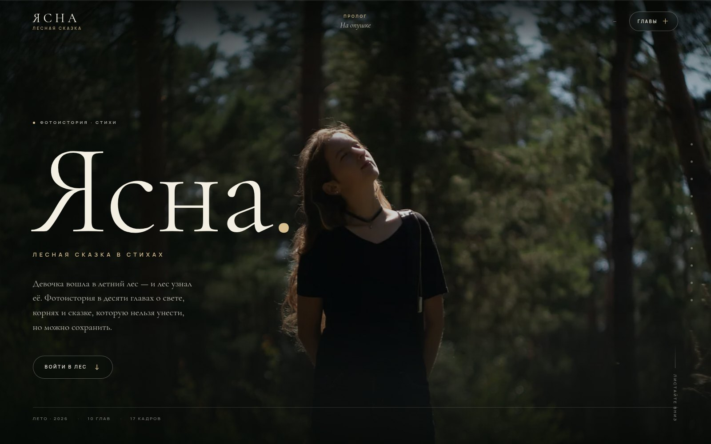
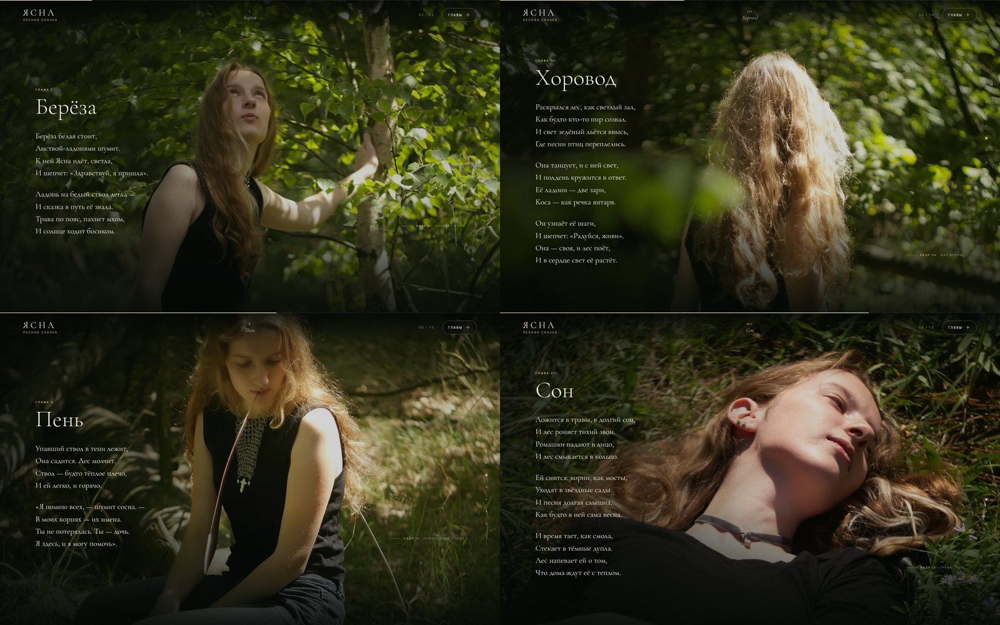

# ЯСНА — лесная сказка в стихах



Одностраничный фотоспектакль: семнадцать кадров, снятых в летнем лесу, и сказка в стихах, которую лес рассказывает девочке Ясне.

Сайт без сборки и зависимостей — чистые HTML, CSS и JavaScript. Фотографии занимают весь экран и остаются на заднем плане, стихи идут поверх: глава за главой, кадр за кадром.



## Что внутри

- **10 глав** — зачин, восемь глав и эпилог; у каждой главы своя фотография на весь экран и своя часть стихотворной сказки.
- **Фиксированная фотографическая сцена.** Все кадры лежат слоями за текстом; при прокрутке главы сменяют друг друга плавным кроссфейдом, активный кадр медленно «дышит» (Ken Burns).
- **Кинематографическая типографика** — Cormorant Garamond для стихов, Manrope для подписей; крупные заглавия, тонкие линии, тёплое золото на тёмно-зелёном.
- **Навигация по сказке** — вертикальный рельс глав, счётчик, полоса прогресса и полноэкранное оглавление с крупными названиями.
- **Все 17 кадров** в финальной ленте-коде: горизонтальная прокрутка, клавиатура и лайтбокс со стрелками, Escape и свайпами.
- **Адаптив** для десктопа, планшета и телефона; на мобильных поэма читается поверх нижней части кадра.
- **Доступность**: skip-link, семантические заголовки, подписи кадров для скринридеров, focus-состояния, нативные `<dialog>`, уважение `prefers-reduced-motion`.
- **Без JavaScript** текст сказки остаётся полностью читаемым, а вместо фотографий показываются размытые LQIP-подложки.
- **Производительность**: WebP + JPEG в двух размерах, ленивая загрузка кадров, инлайновые 24-пиксельные LQIP, локальные шрифты с сабсетами, preload обложки.

## Как открыть

Запустите локальный сервер из папки проекта:

```bash
cd web/fairy-tail
python3 -m http.server 8000
```

Затем откройте <http://localhost:8000>.

Сервер нужен, чтобы браузер без ограничений загрузил локальные шрифты (`file://` может заблокировать их из-за CORS).

## Структура

```text
fairy-tail/
├── index.html                 # вся сказка статически, без шаблонизаторов
├── style.css                  # токены, сцена, главы, финал, диалоги, адаптив
├── script.js                  # смена кадров, ленивая загрузка, оглавление, лайтбокс
├── favicon.svg
├── poem.txt                   # текст сказки в чистом виде
├── preview.jpg                # обложка проекта
├── preview-gallery.jpg        # коллаж глав
├── assets/og-cover.jpg        # картинка для Open Graph
├── photos/                    # исходники (17 JPEG, не изменяются)
├── assets/photos/             # веб-версии: 1800px и 900px, JPEG + WebP
│   ├── <slug>-1800.jpg|webp
│   ├── <slug>-900.jpg|webp
│   ├── lqip/<slug>.jpg        # 24px размытые заглушки
│   └── manifest.json          # размеры, байты, средний цвет, пути
├── fonts/                     # 6 woff2 (Cormorant Garamond + Manrope, кириллица/латиница)
└── scripts/
    └── optimize-images.py     # воспроизводимая подготовка фотографий
```

## Как это устроено

### Сцена

В `index.html` лежат 11 слоёв `.stage__layer` — по одному на обложку, зачин, восемь глав и эпилог. У каждого слоя есть `data-photo` (slug кадра) и инлайновые CSS-переменные:

- `--pos` — `object-position` для кадра (какую часть вертикальной фотографии показать в широком окне);
- `--lqip` — base64-кодированная 24-пиксельная заглушка, размытая средствами CSS.

`script.js` инжектирует в слой адаптивный `<picture>` (WebP + JPEG, `srcset` 900/1800) и плавно проявляет его. Загружаются только текущая глава и её соседи, остальные — по мере приближения. Это позволяет сохранить полноэкранные фотографии и не тянуть сразу все 14 МБ.

Какая глава активна, определяется по «линии фокуса» на 42% высоты окна: последняя секция, чей верх пересёк эту линию, получает активный слой. Смена слоя запускает кроссфейд, обновление заголовка, счётчика и рельса.

### Стихи

Поэма встроена в HTML обычным текстом — она доступна скринридерам, поиску и читается без JavaScript. Каждая строфа — `<p class="stanza">`, каждая строка — `<span class="line">`. Появление строк анимируется через `IntersectionObserver` и класс `.is-revealed`; у `html.js`-режима есть начальные `opacity: 0`, поэтому без JS текст виден сразу.

### Диалоги

Оглавление и лайтбокс — нативные `<dialog>`: браузер сам удерживает фокус внутри, закрывает по Escape и возвращает фокус на кнопку. Лайтбокс дополнительно поддерживает стрелки и свайпы.

### Ленивая лента кадров

Финальная лента из 17 фотографий собирается из массива метаданных только когда читатель приближается к финалу (`IntersectionObserver` с запасом 900px). До этого в DOM нет ни одного кадра — страница остаётся лёгкой.

## Фотографии

Исходники лежат в `photos/` и не изменялись. Веб-версии готовит скрипт `scripts/optimize-images.py`:

- длинная сторона 1800 и 900 px, sRGB, без метаданных;
- JPEG (progressive, q84) и WebP (q80);
- LQIP 24px;
- `manifest.json` с размерами, байтами и средним цветом.

```bash
cd web/fairy-tail
python3 scripts/optimize-images.py --verify-only   # проверить готовые файлы
python3 scripts/optimize-images.py --force         # перегенерировать всё
```

## Отношение к forest-gallery

Проект использует тот же практичный фундамент, что и `web/forest-gallery`: локальные шрифты с unicode-range, оптимизацию фотографий, progressive enhancement, `prefers-reduced-motion`, доступные диалоги и адаптив. Визуально и сценарно это другая вещь: не редакционная галерея, а линейная фотоистория с фиксированной сценой, стихотворной сказкой и кинематографическим монтажом кадров.

## Лицензия

Код проекта можно использовать и адаптировать. Фотографии принадлежат автору съёмки; перед публикацией вне проекта уточните права.
