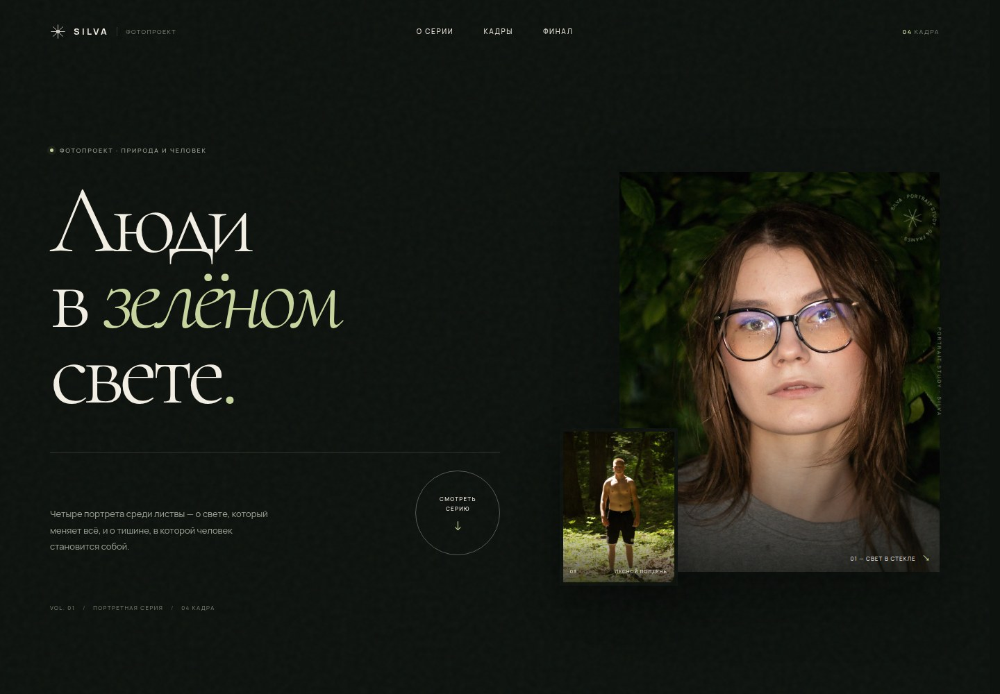
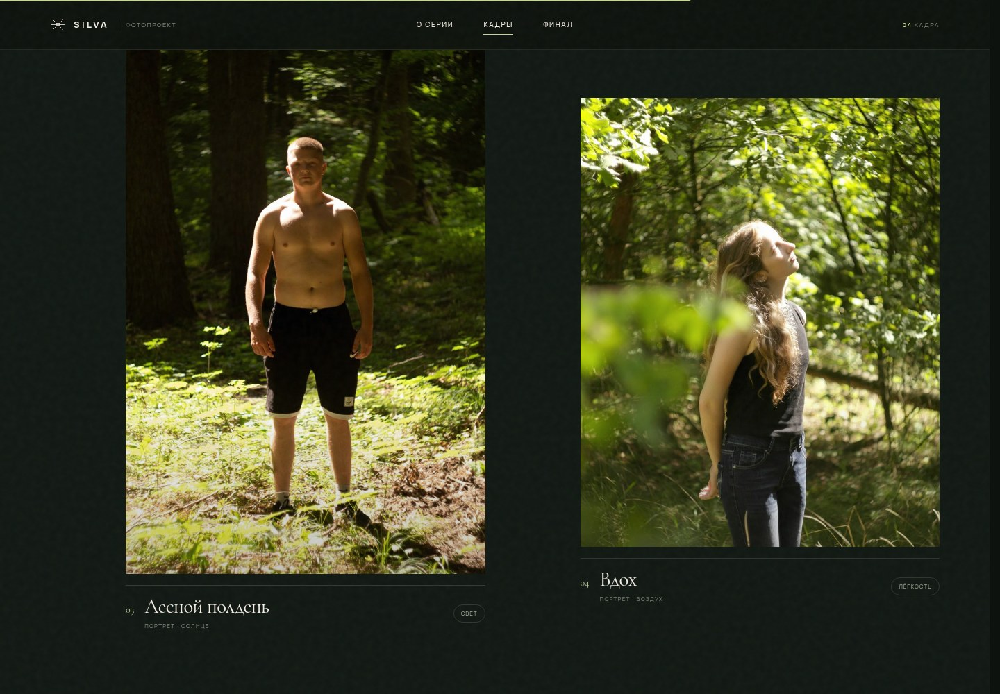

# SILVA — фотогалерея



Небольшой одностраничный сайт-галерея с четырьмя портретными фотографиями. Без сборки и зависимостей: чистые HTML, CSS и JavaScript.

## Что внутри

- адаптивная редакционная вёрстка для десктопа, планшета и телефона;
- полноэкранный просмотр с клавиатурной навигацией (`←` / `→`, `Home` / `End`, `Esc`), свайпами и миниатюрами;
- плавные появления секций с поддержкой `prefers-reduced-motion`;
- локальные шрифты Cormorant Garamond и Manrope, оптимизированные версии фотографий в двух размерах;
- доступная навигация: skip-link, подписи кнопок, focus-состояния, `aria`-атрибуты, удержание фокуса в меню и просмотрщике.



## Как открыть

Запустите локальный сервер из папки проекта:

```bash
cd web/forest-gallery
python3 -m http.server 8000
```

Затем откройте <http://localhost:8000>.

Локальные шрифты подключаются через `@font-face`. При открытии `index.html` напрямую через `file://` браузер может заблокировать их загрузку из-за CORS, поэтому локальный сервер — рекомендуемый способ.

## Структура

```text
forest-gallery/
├── index.html
├── style.css
├── script.js
├── favicon.svg
├── preview.jpg
├── preview-gallery.jpg
├── fonts/
│   ├── cormorant-garamond-*.woff2
│   └── manrope-*.woff2
└── img/
    ├── *-800.jpg
    └── *-1600.jpg
```

Фотографии уменьшены до 800 и 1600 px по длинной стороне, перекодированы в прогрессивный JPEG и очищены от метаданных. Оригиналы не изменялись.
